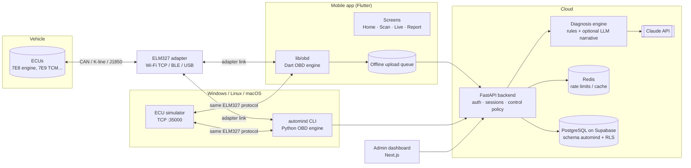

# AutoMind AI — Architecture

> العربية في الأسفل · Arabic summary at the end.

## 1. Big picture



Two links exist and are always reported separately (UI, logs, DB):

| Link | Endpoints | Typical failure | Reported as |
|---|---|---|---|
| **Adapter link** | phone/PC ↔ OBD adapter | wrong Wi-Fi, IP/port, BLE out of range | `adapter_status` |
| **ECU link** | adapter ↔ vehicle computers | ignition off, unsupported protocol, bus error | `ecu_status` |

## 2. Components and boundaries

The communication engine, the diagnosis engine and the UI are separate layers that only exchange plain data:

```
transport  →  elm327 (commands, prompt, errors)  →  frames (CAN ISO-TP / legacy)  →  pids/dtc decoders
     →  ObdClient (connect, supported PIDs, DTCs, freeze frame, VIN, live)  →  Recording v1 (JSON)
     →  DiagnosticInput  →  rules  →  DiagnosisResult  →  reports (HTML/JSON) / API / app UI
```

| Layer | Python (backend/automind) | Dart (mobile/lib) | Notes |
|---|---|---|---|
| Transports | `obd/transport/{tcp,ble,serial,loopback}.py` | `lib/obd/transport/*` | iOS: Wi-Fi + BLE only (no Bluetooth Classic SPP without MFi) |
| ELM327 layer | `obd/elm327.py` | `lib/obd/elm327*.dart` | one command in flight, `>` prompt, error mapping, clone tolerance |
| Framing | `obd/frames.py` | `lib/obd/frames*.dart` | headers ON; CAN 11/29-bit + ISO-TP, J1850/ISO9141/KWP with checksum; headers-off fallback |
| Decoding | `obd/pids.py`, `obd/dtc.py` | `lib/obd/pids*.dart` | **single source**: `shared/obd/pids.json` |
| Client | `obd/client.py` | `lib/obd/obd_client.dart` | only requests PIDs the ECU reports as supported |
| Recording / replay | `recording/` | `lib/obd/recorder*.dart` | `shared/schemas/recording.v1.schema.json` |
| Simulator | `simulator/` (TCP server) | `DemoTransport` (in-process) | identifies as `AT@1 = AUTOMIND SIMULATOR` → always demo |
| Diagnosis | `diagnosis/` | — (server) | app shows KB meanings offline, full analysis online |
| Reports | `reports/` | report screen | DEMO / REPLAY banners + watermark |
| API | `api/`, `db/`, `core/`, `control/` | `lib/api/*` | contract: `docs/API.md` |

## 3. Three operating modes, one engine

| Mode | Data source | `data_mode` | Label |
|---|---|---|---|
| Live | real adapter + vehicle | `live` | none |
| Demo | AutoMind simulator (in-app or PC TCP) | `demo` | DEMO banner + watermark, `[DEMO]` prefix |
| Replay | stored recording | `replay` (original mode kept inside the recording) | REPLAY banner |

* The simulator answers `AT@1` with `AUTOMIND SIMULATOR`; both engines force `demo` when they see it, so simulated data can never be stored as `live`.
* The database enforces `data_mode` on sessions, recordings, connections and control operations; a demo session needs `demo_scenario_key`, a replay session needs `source_recording_id`.
* Reports refuse to render when the metadata mode differs from the diagnosis mode.
* The diagnosis engine is a pure function of `DiagnosticInput`; `input_sha256` excludes `data_mode`, so the same data yields the same findings in all modes (tested).

## 4. Diagnosis engine

1. **Context** – each sample is tagged with an operating condition (`engine_off`, `cold_idle`, `warm_idle`, `free_rev`, `cruise`, `accel`, `decel`) from RPM, speed and coolant temperature.
2. **Rules** – specialised rules per fault family (MAP plausibility, fuel trim, misfire, charging, coolant warm-up, overheating, temperature-sensor circuits, O2 activity, catalyst, idle speed, A/C from manual gauge readings). Each rule produces:
   * **evidence** — measured (`is_measured=true`: statistics, freeze frame, user measurements) vs inferred (`kb_reference`, `missing_data`);
   * **ranked causes** — priors updated by supporting/contradicting evidence;
   * **tests to confirm**, **actions**, **parts candidates** (always `requires_confirmation`);
   * **missing data** — what to measure next.
3. **Generic rule** – any code without a specialised rule gets the KB description and the KB's general causes, explicitly marked as general knowledge. Codes not in the KB are reported as unknown — no description is invented.
4. **Confidence** – starts from whether a DTC exists, rises with abnormal measured evidence, falls with normal evidence and missing data; capped at 0.9. A DTC alone stays at most `suspected`. `confirmed` is reserved for a technician-verified test.
5. **Health score** – 100 minus severity × confidence; capped at 84 with any stored code, 65 with a high-severity finding, 35 with a critical one.
6. **LLM narrative (optional)** – Claude (`claude-opus-5-5`, structured output, server-side refusal fallback) rewrites the structured result as an owner explanation and a technician note in Arabic and English. It receives no raw data beyond the result and is instructed not to add facts or change rankings. Failures fall back to the rule result.

Reference ranges are generic values for typical naturally-aspirated gasoline engines and are labelled as such; manufacturer-specific specs come later through licensed Manufacturer Packs.

## 5. AutoMind Control (safety model)

* The phone holds the OBD connection, so the **server authorises, the device executes, the server audits**.
* Procedures live in `automind.service_procedures` with level 1–4, risk and safety category. DB constraints make brakes/steering/airbag/immobilizer/odometer procedures impossible to enable by default, and odometer changes, emissions deletes, immobilizer bypass and SRS crash-data resets permanently prohibited.
* Anything beyond level 1 needs an active `procedure_allowlist` row (make/model/years/ECU/adapter, certified device) approved by a platform admin.
* `clear_dtcs` (service 04) additionally requires engine off, speed 0 (checked from live data on the device) and explicit consent; the Python client refuses to send it without a server-approved authorisation.
* No undocumented or experimental commands are ever sent to a vehicle. A standard ELM327 is treated as a read-only diagnostic tool plus service 04.

## 6. Data & storage

See `docs/DATABASE.md`. Key choices: dedicated `automind` schema; RLS with a NOLOGIN `automind_app` role set per transaction; app-layer AES-256-GCM for VIN/plate/MFA secrets with HMAC blind index; monthly-partitioned `telemetry_readings` with BRIN indexes and partition-drop retention; per-session aggregates kept long-term; append-only audit log.

## 7. Security

See `docs/SECURITY_PRIVACY.md`: Argon2id, short-lived JWT + rotating refresh tokens with reuse detection, TOTP MFA required for admins, rate limiting (Redis), CORS allow-list, security headers, no secrets in the mobile app, consent records, data export/deletion (Saudi PDPL).

## 8. Deployment

* `docker-compose.yml` — Postgres 17 + Redis + API + admin web + simulator for local development.
* Production — Supabase Postgres (project `vamzjicogedaikojowum`, schema `automind`), API container (any container host), web container, Redis (managed). Mobile builds via CI (Android) and macOS/Xcode (iOS).
* CI — `.github/workflows/ci.yml`: KB validation, backend lint + tests on Postgres, web lint/type/test/build, Flutter analyze/test/APK.

---

## الملخص بالعربية

* **المنظومة**: تطبيق جوال (Flutter) يتصل بجهاز ELM327 عبر Wi-Fi أو BLE، وأداة سطر أوامر على ويندوز بلغة Python بنفس المنطق، ومحاكي ECU، وخادم FastAPI، ومحرك تشخيص، ولوحة إدارة Next.js، وقاعدة بيانات PostgreSQL على Supabase.
* **فصل الطبقات**: محرك الاتصال ← فك الترميز ← التسجيل ← محرك التشخيص ← التقارير والواجهة. لا تعتمد أي طبقة على الواجهة.
* **الاتصالان منفصلان دائما**: اتصال الجوال بالجهاز، واتصال الجهاز بكمبيوتر السيارة، ويظهر كل منهما بحالة مستقلة.
* **الأوضاع الثلاثة**: حي وتجريبي وإعادة تشغيل بنفس محرك التحليل، والبيانات التجريبية لا يمكن أن تُحفظ أو تُعرض كبيانات حقيقية (المحاكي يعرّف نفسه، وقاعدة البيانات والتقارير تفرض ذلك).
* **التشخيص**: قواعد فنية تفصل البيانات المقاسة عن الاستنتاجات، وترتب الأسباب حسب الأدلة، وتقترح اختبارات تأكيد قبل أي قطعة، ولا تتجاوز الثقة 90% دون اختبار فعلي. الذكاء الاصطناعي اختياري ويعيد صياغة النتيجة فقط دون إضافة معلومات.
* **التحكم بالسيارة**: الخادم يصرّح والجهاز ينفذ والخادم يوثق. الوظائف الخطرة معطلة افتراضيا بقيود في قاعدة البيانات، وتعديل العداد وتعطيل الانبعاثات وتجاوز مانع التشغيل محظورة نهائيا.
