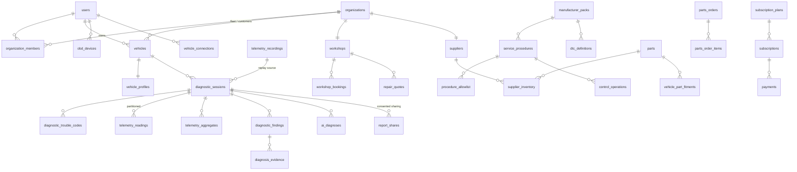

# AutoMind AI — Database design

* **Engine**: PostgreSQL 17 on Supabase (project `vamzjicogedaikojowum`), schema **`automind`** (isolated from anything else in the database). Local/CI: PostgreSQL 16/17.
* **Source of truth**: `supabase/migrations/*.sql` (applied in filename order).
* **Access**: only the FastAPI backend. The schema is not exposed through Supabase PostgREST; `anon`/`authenticated` have no privileges on it.

## Migrations

| File | Content |
|---|---|
| `20261021200000_automind_core_schema.sql` | all tables, constraints, indexes, triggers |
| `20261021200100_automind_telemetry_partitions.sql` | monthly partitions for telemetry, retention + aggregate functions |
| `20261021200200_automind_rls.sql` | `automind_app` role, helper functions, RLS policies, privilege guards |
| `20261021200300_automind_seed_reference.sql` | standard OBD-II pack, subscription plans, control procedures |

> On Supabase these were applied as smaller chunks (the remote tool times out on long statements). The remote state equals these files except the last hardening step listed in "Pending on Supabase" below.

## Entity overview



### Tables by domain (47 incl. partitions' parent)

| Domain | Tables |
|---|---|
| Identity & tenancy | `users`, `auth_sessions`, `organizations`, `organization_members`, `user_consents`, `data_requests` |
| Vehicles & devices | `vehicles`, `vehicle_profiles`, `obd_devices`, `vehicle_connections` |
| Diagnostics | `diagnostic_sessions`, `dtc_definitions`, `diagnostic_trouble_codes`, `telemetry_readings` (partitioned), `telemetry_aggregates`, `telemetry_recordings`, `diagnostic_findings`, `ai_diagnoses`, `diagnosis_evidence` |
| Control | `service_procedures`, `procedure_allowlist`, `control_operations`, `manufacturer_packs` |
| Maintenance | `maintenance_records` |
| Garage | `workshops`, `report_shares`, `workshop_bookings`, `repair_quotes`, `workshop_reviews` |
| Parts | `parts`, `vehicle_part_fitments`, `suppliers`, `supplier_inventory`, `parts_orders`, `parts_order_items` |
| Commerce | `subscription_plans`, `subscriptions`, `payments`, `notifications` |
| Operations | `audit_logs` (append-only), `system_errors` |

## Key rules enforced by the database

* **Data provenance**: `data_mode ∈ {live, demo, replay}` on sessions, recordings, connections, control operations. Demo sessions require `demo_scenario_key`; replay sessions require `source_recording_id`.
* **VIN privacy**: only ciphertext + HMAC blind index (+ the non-personal WMI and model-year code) are stored; ciphertext and blind index must be present together. Unique per owner/org on the blind index.
* **Control safety** (`service_procedures` CHECKs): safety-critical categories never `enabled_by_default`; odometer always prohibited; prohibited ⇒ risk `prohibited` and never enabled. Allow-list rows can only be active with an approver and timestamp.
* **Parts orders** must state `diagnosis_confirmation` (`confirmed_by_technician`, `confirmed_by_test`, `user_acknowledged_unconfirmed`, `not_diagnosis_related`).
* **Quotes**: `total = subtotal + vat_amount` (VAT default 15 %).
* **Subscriptions**: exactly one subject (user xor organization); at most one active subscription per subject.
* **Audit log** is append-only (trigger rejects UPDATE/DELETE).
* **Manufacturer packs**: `(key, version)` unique; published packs need a checksum and publish date.

## Row Level Security

Per request the backend runs, inside one transaction:

```sql
select set_config('app.user_id', '<user uuid>', true);
set local role automind_app;   -- NOLOGIN role subject to all policies
```

Helpers (SECURITY DEFINER, `search_path=''`): `current_user_id()`, `is_platform_admin()`, `is_platform_staff()`, `is_org_member(org, roles)`, `can_access_vehicle()`, `can_write_vehicle()`, `can_access_session()`, `can_write_session()`, `workshop_org()`, `supplier_org()`.

* Users see their own rows; organization members see the organization's rows by role.
* A workshop sees a customer's session **only** through an active, unexpired, unrevoked `report_shares` row for that workshop's organization — never other workshops.
* Catalogue tables (procedures, packs, DTC definitions, plans, parts, fitments) are readable by signed-in users and writable by platform admins.
* Triggers stop privilege escalation: a user cannot change their own `platform_role`, `status`, password hash or lockout fields, and cannot mark a device as certified.
* `auth_sessions` and `system_errors` are not accessible to `automind_app` at all.

## Time-series strategy (live data)

* Raw decoded samples go to `telemetry_readings`, **range-partitioned by month** on `ts`, PK `(session_id, signal, ts)`, BRIN index on `ts` per partition. `ensure_telemetry_partitions(back, ahead)` creates partitions idempotently (run at API start-up and daily); a default partition catches bad clocks.
* Volume estimate: 60–120 s session × ~20 samples/s ≈ 1.2k–2.4k rows/session (≈ 150 kB). 100k sessions/month ≈ 200 M rows/month — monthly partitions keep that manageable and droppable.
* **Retention**: `drop_old_telemetry_partitions(retain_months)` detaches and drops whole partitions (instant, no vacuum debt). Plan-based retention of the full session is handled by keeping the **recording** (compressed JSON in object storage, `telemetry_recordings.expires_at`) and the long-lived `telemetry_aggregates` (min/max/avg/stddev per signal per session) — enough for trend comparison between scans.
* Operational tables never hold raw per-sample data.

## Pending on Supabase

Everything is applied except **one function**, `automind.drop_old_telemetry_partitions` (retention). Supabase asks for an interactive confirmation for SQL containing `DROP TABLE`, and that prompt timed out. To apply it: open the Supabase SQL editor for project `vamzjicogedaikojowum`, paste the `drop_old_telemetry_partitions` function from `supabase/migrations/20261021200100_automind_telemetry_partitions.sql` plus `revoke all on function automind.drop_old_telemetry_partitions(int) from public, automind_app;`, and run it. It is only needed once telemetry is older than the retention window (6 months by default).
